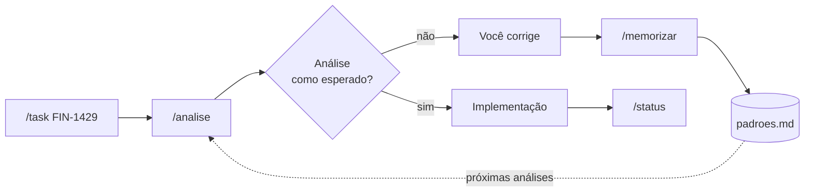

<!-- LOGO: substitua o caminho abaixo pela sua logo (ex. assets/logo.png) -->
<p align="center">
  
</p>

<h1 align="center">perro</h1>

<p align="center">
  <strong>Harness para Claude Code que organiza o workflow de trabalho:<br/>da task no ClickUp até a análise, com padrões que evoluem a cada correção.</strong>
</p>

<p align="center">
  
  
  
</p>

<p align="center">
  <a href="#-instalação">Instalação</a> •
  <a href="#-skills">Skills</a> •
  <a href="#-fluxo-de-trabalho">Fluxo</a> •
  <a href="#-desenvolvimento">Desenvolvimento</a> •
  <a href="#-como-contribuir">Contribuir</a>
</p>

---

## ✨ O que é

O **perro** é um plugin de Claude Code com skills para o dia a dia de desenvolvimento:

- inicia uma task do ClickUp criando a branch e um documento de contexto
- analisa a tarefa antes de implementar, com hipóteses, riscos e plano de validação
- publica o status e move a task no ClickUp
- memoriza as suas correções como padrões, que passam a guiar as próximas análises

A ideia central: **o harness aprende com o seu jeito de trabalhar.** Cada diferença entre o que o agente fez e o que você esperava pode virar um padrão.

---

## 🧰 Skills

| Comando | O que faz |
|---|---|
| `/task FIN-1429` | Busca a task no ClickUp, cria a branch `FIN-1429/<slug>` e gera `.harness/tasks/FIN-1429.md` com problema, objetivo, critérios e lacunas |
| `/analise` | Analisa a tarefa antes de codar: tipo, impacto, hipóteses (bugs), alternativas, plano de validação e nível de confiança |
| `/status <texto>` | Publica `dia DD/MM - <texto>` como comentário na task e, se você pedir, troca o status |
| `/memorizar` | Transforma uma correção sua em padrão, salvo em `memoria/padroes.md` |

> [!TIP]
> Dentro do plugin, o Claude Code pode exibir as skills com prefixo, como `/perro:task`. Mencionar o ID da task na conversa também aciona a skill.

<details>
<summary><strong>📄 Exemplo: documento gerado pelo <code>/task</code></strong></summary>

```markdown
# FIN-0000 — Ajustar cálculo de taxa

- **Link:** https://app.clickup.com/t/...
- **Status:** to do
- **Branch:** FIN-0000/ajusta-calculo-taxa

## Problema
- **Situação atual:** a taxa é calculada sobre o valor bruto
- **Comportamento esperado:** calcular sobre o valor líquido
- **Impacto:** vendedores veem valor incorreto no extrato
- ...

## Lacunas
- Não está claro se a regra vale para pedidos já faturados

## Revisão
- Confiança: Média — critérios de aceite não definidos na task
```

</details>

<details>
<summary><strong>💬 Exemplo: <code>/status</code> com troca de status</strong></summary>

```
/status realizei o estudo da task e já possuo um plano de ação, move para em andamento
```

Prévia exibida antes de publicar:

```
Task: FIN-0000
Comentário: dia 26/10 - realizei o estudo da task e já possuo um plano de ação
Status: to do → em andamento
```

</details>

---

## 🔄 Fluxo de trabalho



---

## 🚀 Instalação

### Pré-requisitos

| Ferramenta | Uso |
|---|---|
| [Claude Code](https://docs.claude.com/en/docs/claude-code) | Executa o plugin |
| MCP do ClickUp configurado no Claude Code | Skills `task` e `status` |
| `git`, `make` e `python3` | Automação do repositório |

> [!IMPORTANT]
> A conexão com o ClickUp do claude.ai **não** é compartilhada com o Claude Code. Configure o MCP do ClickUp no Claude Code antes de usar `/task` e `/status`.

### 1. Clone o repositório

```bash
git clone <url-do-repositorio> ~/harness
```

> [!NOTE]
> As skills leem os padrões em `~/harness/memoria/padroes.md`. Se clonar em outro caminho, ajuste esse caminho nas skills `analise` e `memorizar`.

### 2. Instale no Claude Code

```
/plugin marketplace add ~/harness
/plugin install perro@perro
```

Abra uma nova sessão e rode `/task` com o ID de uma task para validar.

<details>
<summary><strong>Prefere testar sem instalar?</strong></summary>

```bash
cd ~/harness
make dev
```

Abre o Claude Code com a versão local do plugin, só para aquela sessão.

</details>

---

## 🛠 Desenvolvimento

```bash
make help
```

| Comando | O que faz |
|---|---|
| `make check` | Valida os JSONs e o frontmatter das skills |
| `make dev` | Abre o Claude Code com a versão local, sem instalar |
| `make bump BUMP=minor` | Incrementa a versão (`patch`, `minor` ou `major`) |
| `make commit MSG="..."` | Commita com a versão na mensagem |
| `make update` | Atualiza o plugin instalado |
| `make release MSG="..."` | `check` → `bump` → `commit` → `update` |

### Estrutura

```
~/harness/
├── .claude-plugin/
│   ├── plugin.json          # metadados e versão
│   └── marketplace.json     # marketplace local
├── skills/
│   ├── task/SKILL.md
│   ├── analise/SKILL.md
│   ├── status/SKILL.md
│   └── memorizar/SKILL.md
├── memoria/
│   └── padroes.md           # padrões aprendidos
├── Makefile
└── README.md
```

<details>
<summary><strong>⚠️ Plugin não atualizou?</strong></summary>

1. Confirme que a versão subiu: `make version`
2. Rode `/plugin marketplace update perro` dentro do Claude Code
3. Se ainda não atualizou, reinstale:
   ```
   /plugin uninstall perro@perro
   /plugin install perro@perro
   ```
4. Abra uma nova sessão

</details>

---

## 🤝 Como contribuir

### Fluxo

1. Crie uma branch: `git checkout -b <ID-da-task>/<descricao-curta>`
2. Faça a mudança e teste com `make dev`
3. Valide com `make check`
4. Abra um Pull Request explicando **o que mudou** e **por quê**

### Criando uma nova skill

```bash
mkdir -p skills/minha-skill
```

Crie `skills/minha-skill/SKILL.md`:

```markdown
---
name: minha-skill
description: O que a skill faz e quando deve ser usada. Seja específico sobre os gatilhos.
---

# Minha skill

Instruções para o agente.
```

<details>
<summary><strong>📐 Boas práticas para skills</strong></summary>

- **Uma skill, uma ação.** Se o comportamento depende do estado, provavelmente são duas skills.
- **Explique o porquê**, não só a regra. O agente lida melhor com casos de borda quando entende o motivo.
- **Confirme antes de ações visíveis ao time**, como comentários, troca de status e push.
- **Formato de saída fixo**, para comparar resultados entre versões.
- **Mantenha o `SKILL.md` enxuto.** Se passar de ~300 linhas, separe em arquivos de referência.

</details>

### Regras

> [!CAUTION]
> - Nunca inclua secrets, tokens ou credenciais. Referencie apenas o nome da variável de ambiente.
> - Exemplos, testes e documentação usam **somente dados fictícios**.
> - Não versione documentos de `.harness/tasks/`: eles contêm contexto de tarefas reais.

### Commits

Prefira mensagens curtas, com o escopo na frente:

```
analise: adiciona plano de validação
status: permite trocar status da task
```

---

<p align="center">
  Feito com ☕ por André Santos
</p>